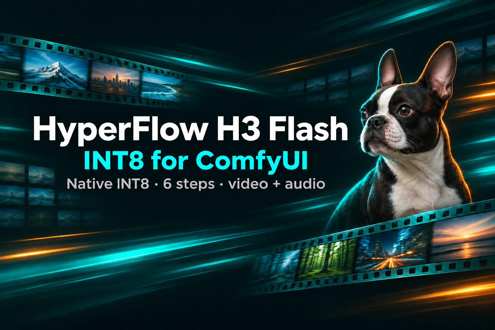

# comfyui_hyperflow_int8_nodes

Run [HyperFlow H3 Flash](https://huggingface.co/VideoRebirthAI/hyperflow-h3-flash) in ComfyUI on ComfyUI's own INT8
kernels: text, image and reference to video with synchronized stereo audio, in 6 steps. Weights:
[BennyDaBall/HyperFlow-H3-Flash-INT8-ComfyUI](https://huggingface.co/BennyDaBall/HyperFlow-H3-Flash-INT8-ComfyUI).

## Speed

One RTX 5090, 1344 x 768, 124 frames (5.2 s) with audio, 6 steps, mean of 5 seeds, queue to saved MP4:

| Setup | Time per clip | vs stock H3 |
|---|---:|---:|
| **This pack + the INT8 checkpoints** | **46.1 s** | **3.0x faster** |
| This pack + ComfyUI's *Model Sparse Attention* node | about 38 s | 3.7x faster |
| Official HyperFlow `Q4_K_M` GGUF + official nodes | 66.0 s | 2.1x faster |
| Stock MiniMax H3, 20 steps | 139.1 s | 1x |

Video Rebirth publishes 99 s for the official `Q4_K_M` GGUF setup on an RTX 5090. Peak VRAM with this pack was 24.2 GB.

## What you get

- **HyperFlow INT8 Loader**, a ComfyUI node that runs both HyperFlow checkpoints: `fl2va` (text, first frame, first
  and last frame) and `ref2va` (reference images).
- **The INT8 checkpoints** on [Hugging Face](https://huggingface.co/BennyDaBall/HyperFlow-H3-Flash-INT8-ComfyUI), ready for `ComfyUI/models/diffusion_models/`.
- **HyperFlow LoRA**, a node that makes regular MiniMax H3 LoRAs work on HyperFlow H3 Flash models (see
  [LoRAs](#loras)).
- **pi-H3 Adapter for HyperFlow**, a node that runs [pi-H3](https://huggingface.co/Lakonik/pi-H3)'s 2-step and 4-step
  adapters on HyperFlow H3 Flash (see [pi-H3 on HyperFlow](#pi-h3-on-hyperflow)).
- **Nine ready-to-run workflows** in `example_workflows/`, also under **Workflow > Browse Templates**: text to video,
  text to video with sparse attention, text to video with a LoRA, first frame, first and last frame, reference
  to video, and pi-H3 on HyperFlow at 2 steps, 4 steps and 480p max speed.


## Quick start

1. Install this pack and the official [ComfyUI-HyperFlow-Flash](https://github.com/Video-Rebirth/ComfyUI-HyperFlow-Flash)
   pack (see [Install](#install)).
2. Download a checkpoint from [Hugging Face](https://huggingface.co/BennyDaBall/HyperFlow-H3-Flash-INT8-ComfyUI) plus the text encoder and VAEs from
   [Comfy-Org/MiniMax-H3](https://huggingface.co/Comfy-Org/MiniMax-H3) (see [Model files](#model-files)).
3. Open a template from **Workflow > Browse Templates** and queue it.

## Examples

AI-generated with this pack and the INT8 checkpoints, one run each, seed 42. Click for the video on Hugging Face.

### Text to video (`fl2va`, 10 s)

[](https://huggingface.co/BennyDaBall/HyperFlow-H3-Flash-INT8-ComfyUI/blob/main/examples/t2v_int8_example.mp4)

### First frame to video (`fl2va`, 10 s): a night train full of passengers from different eras

[](https://huggingface.co/BennyDaBall/HyperFlow-H3-Flash-INT8-ComfyUI/blob/main/examples/i2v_int8_example.mp4)

### Reference to video (`ref2va`): a character, a scooter and a harbor square into one shot

[](https://huggingface.co/BennyDaBall/HyperFlow-H3-Flash-INT8-ComfyUI/blob/main/examples/ref2va_int8_example.mp4)

Prompts and reference images are on the [model page](https://huggingface.co/BennyDaBall/HyperFlow-H3-Flash-INT8-ComfyUI).

## Requirements

- A ComfyUI build with native MiniMax-H3 support and the `int8_tensorwise` + `convrot` quantized ops (the
  comfy_kitchen INT8 kernels, torch cu130).
- The official [ComfyUI-HyperFlow-Flash](https://github.com/Video-Rebirth/ComfyUI-HyperFlow-Flash) pack, installed
  next to this one. This pack imports its `model_patch.py`, and the templates use its `HyperFlow Sigmas` node.
- About 16 GB of VRAM for the weights, which stay resident, plus activations. Peak VRAM was 24.2 GB at
  1344 x 768, 124 frames on an RTX 5090.

## Install

### ComfyUI-Manager and the Comfy registry

Install from ComfyUI-Manager (search for `HyperFlow INT8`) or with:

```sh
comfy node install comfyui-hyperflow-int8-nodes
```

Install the official [ComfyUI-HyperFlow-Flash](https://github.com/Video-Rebirth/ComfyUI-HyperFlow-Flash) pack the
same way (`comfyui-hyperflow-flash`), then restart ComfyUI.

### git clone

```sh
cd ComfyUI/custom_nodes
git clone https://github.com/Video-Rebirth/ComfyUI-HyperFlow-Flash
git clone https://github.com/BennyDaBall930/comfyui_hyperflow_int8_nodes
pip install -r ComfyUI-HyperFlow-Flash/requirements.txt
```

Use the python of your ComfyUI install for `pip`, then restart ComfyUI.

### Model files

| Folder in `ComfyUI/models/` | File | Download |
|---|---|---|
| `diffusion_models/` | `minimax_h3_fl2va_hyperflow_flash_int8_convrot.safetensors` (15.9 GB) | [BennyDaBall/HyperFlow-H3-Flash-INT8-ComfyUI](https://huggingface.co/BennyDaBall/HyperFlow-H3-Flash-INT8-ComfyUI) |
| `diffusion_models/` | `minimax_h3_ref2va_hyperflow_flash_int8_convrot.safetensors` (16.3 GB) | [BennyDaBall/HyperFlow-H3-Flash-INT8-ComfyUI](https://huggingface.co/BennyDaBall/HyperFlow-H3-Flash-INT8-ComfyUI) |
| `text_encoders/` | `qwen3vl_32b_minimax_h3_nvfp4_awq.safetensors` | [Comfy-Org/MiniMax-H3](https://huggingface.co/Comfy-Org/MiniMax-H3) |
| `vae/` | `minimax_h3_video_vae_fp16.safetensors`, `minimax_h3_audio_vae_fp32.safetensors` | [Comfy-Org/MiniMax-H3](https://huggingface.co/Comfy-Org/MiniMax-H3) |

`fl2va` covers text, first frame, and first and last frame to video. `ref2va` covers reference images to video. You
only need the variant you use.

```sh
hf download BennyDaBall/HyperFlow-H3-Flash-INT8-ComfyUI minimax_h3_fl2va_hyperflow_flash_int8_convrot.safetensors \
  --local-dir ComfyUI/models/diffusion_models
```

## Usage

Open a template from **Workflow > Browse Templates**, under this pack's folder name (`comfyui_hyperflow_int8_nodes`
after a git clone). The templates are the official HyperFlow templates with the GGUF loader replaced by
**HyperFlow INT8 Loader**:

| Template | Task | Model file |
|---|---|---|
| `hyperflow_int8_t2v` | text to video | `fl2va` |
| `hyperflow_int8_t2v_sparse` | text to video with ComfyUI's *Model Sparse Attention* node | `fl2va` |
| `hyperflow_int8_t2v_lora` | text to video with a MiniMax H3 LoRA (**HyperFlow LoRA** node) | `fl2va` |
| `hyperflow_int8_i2v` | first frame to video | `fl2va` |
| `hyperflow_int8_flf2v` | first and last frame to video | `fl2va` |
| `hyperflow_int8_ref2v` | reference images to video | `ref2va` |

API-format versions are in the [model repo](https://huggingface.co/BennyDaBall/HyperFlow-H3-Flash-INT8-ComfyUI/tree/main/workflows/api)
under `workflows/api/`. Apart from the loader, the sampling settings match the official
templates: `HyperFlow Sigmas` (4, 6 or 8 steps, 6 by default), `euler`, CFG 1, no negative prompt, 1344 x 768. The
two text-to-video templates default to 243 frames (10.1 s at 24 fps); the others default to 124 frames (5.2 s).

To switch an existing API-format graph to this loader, replace its model loader node:

```json
"1": {
  "class_type": "HyperFlowINT8Loader",
  "inputs": {
    "unet_name": "minimax_h3_fl2va_hyperflow_flash_int8_convrot.safetensors",
    "patcher": "legacy"
  }
}
```

### Loader inputs

| Input | Values | Notes |
|---|---|---|
| `unet_name` | any `.safetensors` in `diffusion_models` or `unet` | a converted file; the loader reads the variant, block count and low-rank layout from it |
| `patcher` | `legacy` (default, recommended), `auto` (experimental) | `legacy` is the classic ModelPatcher, as the official GGUF loader uses. `auto` is what `UNETLoader` gets (DynamicVRAM when ComfyUI enables it). On an RTX 5090, `auto` held VRAM at the card limit and slowed down across consecutive runs. |

### Sparse attention

`hyperflow_int8_t2v_sparse` places ComfyUI's core *Model Sparse Attention* node between the loader and the guider:
method `sol-attn`, tau 1.25, start_percent 0.39, end_percent 1.0, dense blocks `0, 1, 45, 46`. Bypass the node
(Ctrl+B) to run dense attention.

### LoRAs

HyperFlow H3 Flash is a pruned MiniMax H3: `fl2va` leaves out source blocks 6, 21 and 22 and renumbers the other 47,
`ref2va` leaves out block 9, and part of the kept layers are stored as low-rank pairs. A LoRA trained on the full
MiniMax H3 addresses blocks by their original number, so with a stock LoRA loader most of it lands on the wrong block
and the low-rank layers are skipped. ComfyUI only prints `lora key not loaded` warnings.

**HyperFlow LoRA** (`HyperFlowLoraBypass`) goes between the model loader and the guider:

- It renumbers the LoRA's blocks to the model's kept blocks. The dropped blocks' parts of the LoRA are left out.
- It adds the LoRA at run time (ComfyUI's bypass mode), so the INT8 weights are not rewritten and the low-rank layers
  get their LoRA part too.
- It reads both common key styles (`diffusion_model.blocks.N...` and kohya `lora_unet_blocks_N_...`).

| Input | Values | Notes |
|---|---|---|
| `lora_name` | a file in `ComfyUI/models/loras/` | a LoRA trained on the full MiniMax H3 video model |
| `strength_model` | 1.0 by default | |
| `dropped_blocks` | `auto` (default) or a list such as `6, 21, 22` | `auto` picks the list from the model's block count |
| `source_blocks` | 50 | blocks of the model the LoRA was trained on |

It works on any HyperFlow H3 Flash model that the **HyperFlow INT8 Loader** or the official **HyperFlow Loader**
gives it. Tested with INT8 safetensors files of both variants and an NVFP4 file; not tested with the GGUF files. A LoRA made
for the full model is not guaranteed to look the same on the distilled one, and the dropped blocks' share of it is
lost. Chain several HyperFlow LoRA nodes for several LoRAs.

### pi-H3 on HyperFlow

[pi-H3](https://huggingface.co/Lakonik/pi-H3) (Lakonik, pi-Flow v2) makes MiniMax H3 video with audio in 2 or 4 steps,
and its DWD adapters skip the VAE decode. A pi-H3 adapter is more than a LoRA: next to rank-64 LoRA pairs it replaces
every block's time modulation and the final layer, and the DWD adapters also replace the last four blocks and add a
pixel head. All of that expects stock H3's time embedding and all 50 blocks, so **Load LakonLab Adapter** cannot put it
on a HyperFlow model.

**pi-H3 Adapter for HyperFlow** (`PiH3HyperFlowAdapter`) goes where Load LakonLab Adapter sits in the pi-H3 workflows,
after the official **HyperFlow Loader**:

- It renumbers the adapter's LoRA past the blocks HyperFlow drops and adds it at run time, low-rank layers included
  (the HyperFlow LoRA node's remap and hooks).
- It installs pi-H3's time modulation on stock H3's time curve. The curve table and the few biases the adapter leaves
  out are read from the stock `minimax_h3_fl2va_pruned_int8_convrot.safetensors` (a few MB; the stock weights are not
  loaded).
- It installs pi-H3's final layer, the DWD adapter's four replaced blocks (HyperFlow blocks 43 to 46) and the DWD pixel
  head, so ComfyUI-piFlow's **DWD Decode** works unchanged.
- Spark-H3 accepts the model too.

| Input | Values | Notes |
|---|---|---|
| `adapter_name` | `pi_h3_2step_dwd_adapter_int8_convrot.safetensors` and the other pi-H3 adapters | in `ComfyUI/models/loras/` |
| `adapter_strength` | 1.0 | scales the LoRA part |
| `time_path` | **pi-H3 (stock H3 time curve)**, or HyperFlow blocks + pi-H3 head | keep the default: the HyperFlow option gave a loud noise bed and clipping on a quiet dialogue scene |
| `stock_base` | `minimax_h3_fl2va_pruned_int8_convrot.safetensors` | only its time table and biases are read |
| `lora_mode` | **bypass**, or merge into dense layers | merge is about 0.7s faster but re-quantizes the dense layers, which on the NVFP4 file throws away its calibrated scales |
| `dropped_blocks` | `auto` | as on the LoRA node |

My numbers, one RTX 5090, 5s with audio, Spark-Attn, warm, the HyperFlow H3 Flash
[NVFP4 file](https://huggingface.co/BennyDaBall/HyperFlow-H3-Flash-NVFP4-ComfyUI) against the author's own workflow on
the stock INT8 base:

| Setup | 1344 x 768, 2 steps | 1344 x 768, 4 steps | 864 x 480, 2 steps, NVENC save | 864 x 480, new prompt | Peak VRAM |
|---|---:|---:|---:|---:|---:|
| **pi-H3 on HyperFlow NVFP4** | **12.7s** | **20.2s** | **4.6s** | **5.5s** | 24 to 28 GB |
| pi-H3, author's workflow, stock H3 INT8 | 13.3 to 13.9s | 22.0s | 4.8s | 8 to 14s | 29 to 31 GB |

At 480p the gain is mostly memory: the NVFP4 model and the text encoder fit in VRAM together, so a new prompt costs
only its text encode. On the stock base the text encoder pushes part of the model out, and the first clip or two after
a new prompt run slower.

The workflows `hyperflow_pih3_t2v_2step`, `hyperflow_pih3_t2v_4step` and `hyperflow_pih3_t2v_480p_max_speed` need
[ComfyUI-piFlow](https://github.com/Lakonik/ComfyUI-piFlow) 1.4.2 or newer,
[Spark-H3](https://github.com/zechengtang/Spark-H3) 0.2.0, the pi-H3 adapters from
[Lakonik/pi-H3](https://huggingface.co/Lakonik/pi-H3), and for the 480p one
[ComfyUI-VideoHelperSuite](https://github.com/Kosinkadink/ComfyUI-VideoHelperSuite) (NVENC save; the clip with sound
is the `-audio.mp4` file).

Picture quality holds up, and pi-H3's own look carries over. The spoken lines come out less reliably than on the
stock base: Whisper heard the scripted line word for word in 4 of 9 HyperFlow clips against 6 of 6 stock clips at
1344 x 768, and 5 of 8 against 8 of 8 at 480p. HyperFlow H3 Flash on its own showed the same "Careful" to "Carful"
slip. Its audio also comes out louder than stock pi-H3's on quiet scenes.

## How it works

HyperFlow H3 Flash ships its own INT8 transformers (`fl2va_int8_convrot/` and `ref2va_int8_convrot/` in
[VideoRebirthAI/hyperflow-h3-flash](https://huggingface.co/VideoRebirthAI/hyperflow-h3-flash)). They are W8A8 with a
rotated input, the same scheme as ComfyUI's native `int8_tensorwise` + `convrot`. This pack loads files in ComfyUI's
MiniMax-H3 layout with that scheme on ComfyUI's own INT8 kernels. The first release of the checkpoints copied Video
Rebirth's INT8 codes and scales bit for bit. Since 2026-11-15 they carry my own lower-error INT8 solve, made from the
BF16 release, in the same layout and format.

The pack is the `HyperFlow INT8 Loader` node (`loader.py`), the `HyperFlow LoRA` node (`lora.py`), the
`pi-H3 Adapter for HyperFlow` node (`pih3.py`) and nine workflow templates in `example_workflows/`.

| Piece | Source |
|---|---|
| Model detection, MiniMax-H3 blocks, INT8 weight loading and GEMMs, attention, sampler | ComfyUI core, unchanged |
| Low-rank linears, split q/k/v, SwiGLU MLP for low-rank blocks, two-time (t, r) embedder | Official `ComfyUI-HyperFlow-Flash/model_patch.py`, imported unchanged |
| 4, 6 or 8-step schedule | Official `HyperFlow Sigmas` node |
| `HyperFlow INT8 Loader` node | This pack (`loader.py`) |
| `HyperFlow LoRA` node | This pack (`lora.py`), on ComfyUI's bypass LoRA hook, unchanged |
| `pi-H3 Adapter for HyperFlow` node | This pack (`pih3.py`); the DWD head and its sampling wrapper are ComfyUI-piFlow's, imported at run time |
| The checkpoints | [Hugging Face](https://huggingface.co/BennyDaBall/HyperFlow-H3-Flash-INT8-ComfyUI): my own INT8 solve from Video Rebirth's BF16 release, in this layout |

The stock MiniMax-H3 forward has no input for HyperFlow's step endpoint `r`, so the stock `UNETLoader` cannot run
these checkpoints on its own.

### Memory

The weights stay resident in VRAM:

| Part | Size |
|---|---|
| INT8 linears | 11.6 GB |
| Low-rank factors, bf16 | 2.6 GB (`fl2va`) or 3.0 GB (`ref2va`) |
| Text refiner, bf16 | 1.5 GB |

Per token, the block linears cost 11.6 G INT8 MACs plus 1.3 G (`fl2va`) or 1.5 G (`ref2va`) bf16 MACs. The stock
50-block dense INT8 MiniMax-H3 costs 19.3 G INT8 MACs.

### The checkpoints

The files on Hugging Face use Video Rebirth's INT8 layout carried to ComfyUI: tensors are renamed, the dropped
blocks are left out, q/k/v are fused and the low-rank factors stay bf16. Since 2026-11-15 the INT8 codes and row
scales of the 120 dense block matrices are my own solve from the BF16 release: closer to BF16 than the official INT8,
at the same size and speed. Every low-rank pair is bit-identical to the source and every unquantized tensor is
bit-exact against the official Q8_0 GGUF; the
[model page](https://huggingface.co/BennyDaBall/HyperFlow-H3-Flash-INT8-ComfyUI#receipts) has the numbers and the
receipts. The loader and the workflows run the first release and the updated files alike.

The updated files also carry the official `hyperflow` header entry, so the official **HyperFlow Loader** reads them
too, with output identical to this pack's loader.

## Credits

- [Video Rebirth](https://huggingface.co/VideoRebirthAI) for HyperFlow H3 Flash, its INT8 checkpoints and the
  official [ComfyUI-HyperFlow-Flash](https://github.com/Video-Rebirth/ComfyUI-HyperFlow-Flash) pack, whose
  `model_patch.py` this pack imports.
- [MiniMax](https://huggingface.co/MiniMaxAI) for MiniMax H3, the base model.
- [Hansheng Chen (Lakonik)](https://huggingface.co/Lakonik) for pi-H3 and
  [ComfyUI-piFlow](https://github.com/Lakonik/ComfyUI-piFlow) (Apache-2.0): the pi-H3 node imports its DWD head, two
  small helpers are adapted from it, and the pi-H3 workflows build on its own.
- [ComfyUI](https://github.com/Comfy-Org/ComfyUI) and Comfy Org for native MiniMax-H3 support, the INT8
  `convrot` ops and kernels, the *Model Sparse Attention* node, and the
  [Comfy-Org/MiniMax-H3](https://huggingface.co/Comfy-Org/MiniMax-H3) text encoder and VAE files.

## License

This project is not affiliated with Video Rebirth, MiniMax or Comfy Org.

- **Code:** GPL-3.0 (see `LICENSE`), because it imports the GPL-3.0 ComfyUI-HyperFlow-Flash pack.
- **Weights:** not included in this repository. HyperFlow H3 Flash and its conversions are Model Derivatives of
  MiniMax H3 under the
  [MiniMax H3 Community License Agreement](https://huggingface.co/MiniMaxAI/MiniMax-H3/blob/main/LICENSE). That
  agreement restricts territory (the EU, UK, South Korea and the US need prior authorization from MiniMax) and
  requires AI-generated content to be disclosed as such.

Powered by MiniMax H3.

**Follow me on X [@BennyDaBall_OG](https://x.com/BennyDaBall_OG) !**

**Want to support my work? Buy me a coffee on [Ko-fi](https://ko-fi.com/bennydaball) !**
